<!-- usefexe · GitHub profile -->
<div align="center">
  
  <br/><br/>
  <a href="https://linkedin.com/in/youssef-it-salah"></a>
  <a href="https://instagram.com/ysf-itsalh"></a>
  <a href="https://github.com/usefexe?tab=repositories"></a>
  
  <br/><br/>
  
</div>

## 01 / About me

I'm **Youssef**, a web developer from Morocco and a learner at **YouCode Safi**. I turn ideas into real projects, explore how things work under the hood, and enjoy the process of debugging as much as building.

```javascript
const youssef = {
  location: "Morocco 🇲🇦",
  focus: ["Frontend Development", "Full Stack Development"],
  learning: ["JavaScript", "React", "Node.js"],
  openTo: ["Collaboration", "New challenges"],
  philosophy: "Understand first. Build second. Improve always."
};
```

## 02 / Tech stack

<table>
  <tr>
    <td><strong>Languages</strong></td>
    <td>
      
      
      
      
    </td>
  </tr>
  <tr>
    <td><strong>Frontend</strong></td>
    <td>
      
      
      
      
      
      
      
      
    </td>
  </tr>
  <tr>
    <td><strong>Backend &amp; Data</strong></td>
    <td>
      
      
      
      
      
    </td>
  </tr>
  <tr>
    <td><strong>Dev tools</strong></td>
    <td>
      
      
      
      
    </td>
  </tr>
  <tr>
    <td><strong>Cloud &amp; Deploy</strong></td>
    <td>
      
      
      
      
      
      
    </td>
  </tr>
  <tr>
    <td><strong>Design</strong></td>
    <td>
      
      
      
    </td>
  </tr>
</table>

## 03 / Featured projects

| Project | What it does | Technologies |
| :--- | :--- | :--- |
| **[DevScope](https://github.com/usefexe/DEVSCOPE)** | Explore GitHub profiles, repositories, and developer shortlists. | `JavaScript` `REST API` `Tailwind CSS` |
| **TACHKILA V2** | Manage a football team, formations, players and match schedules. | `JavaScript` `Tailwind CSS` `LocalStorage` |
| **KumaSpa** | Manage massage services, appointments and client accounts. | `PHP` `MySQL` `HTML/CSS` |

<p align="right"><a href="https://github.com/usefexe?tab=repositories">Explore all repositories →</a></p>

## 04 / GitHub activity

<div align="center">
  
  
  <br/><br/>
  
</div>

---

<div align="center">
  <strong>Curiosity is my favorite framework.</strong>
  <br/>
  <sub>Built with curiosity, one commit at a time.</sub>
  <br/><br/>
  
</div>
